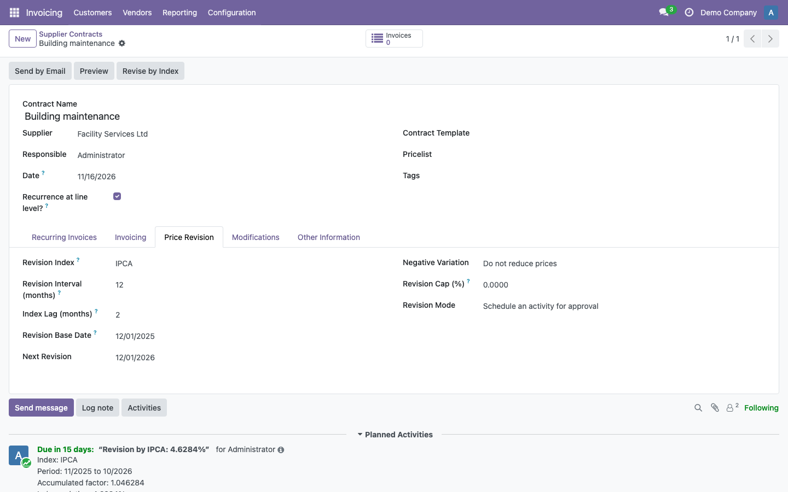
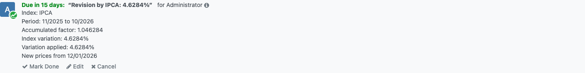
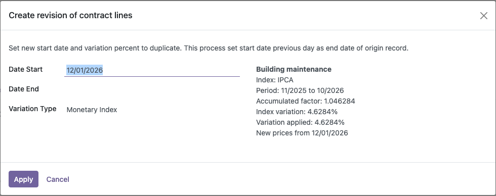
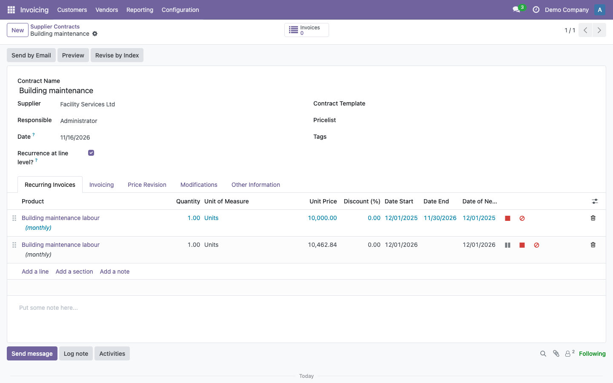

=========================================
Contract Price Revision by Monetary Index
=========================================

.. 
   !!!!!!!!!!!!!!!!!!!!!!!!!!!!!!!!!!!!!!!!!!!!!!!!!!!!
   !! This file is generated by oca-gen-addon-readme !!
   !! changes will be overwritten.                   !!
   !!!!!!!!!!!!!!!!!!!!!!!!!!!!!!!!!!!!!!!!!!!!!!!!!!!!
   !! source digest: sha256:e982eda80a35a2705ded6ca12df5cfa9e53d45390ee3a1d350fb4999fcb902ec
   !!!!!!!!!!!!!!!!!!!!!!!!!!!!!!!!!!!!!!!!!!!!!!!!!!!!

.. |badge1| image:: https://img.shields.io/badge/maturity-Beta-yellow.png
    :target: https://odoo-community.org/page/development-status
    :alt: Beta
.. |badge2| image:: https://img.shields.io/badge/licence-AGPL--3-blue.png
    :target: http://www.gnu.org/licenses/agpl-3.0-standalone.html
    :alt: License: AGPL-3
.. |badge3| image:: https://img.shields.io/badge/github-KMEE%2Fkmee--odoo--addons-lightgray.png?logo=github
    :target: https://github.com/KMEE/kmee-odoo-addons/tree/18.0/contract_price_revision_monetary_index
    :alt: KMEE/kmee-odoo-addons

|badge1| |badge2| |badge3|

This module revises the prices of recurring contracts on their
anniversary by a monetary index (a consumer price index such as IPCA,
INPC or IGP-M, or any index of *Monetary Index Update*), without typing
the percentage.

The revision uses the mechanism of *Contract Price Revision*: the
current line ends on the day before the revision date and a successor
line starts with the revised price, so the price history stays in the
contract and invoices already issued do not change.

The variation is the compound variation of the monthly rates of the
index over the months of the period (by default the twelve months that
end in the month before the revision). While any month of the period is
not published, the revision waits.

Each contract chooses how the revision is applied: an activity for the
responsible to review and approve (default), or automatically on the
revision date. It works for customer and supplier contracts.

**Table of contents**

.. contents::
   :local:

Configuration
=============

The rates of the index must be in *Monetary Index Update*: typed by hand
or fetched by a provider module (for Brazil,
*monetary_index_update_bacen* fetches IPCA, INPC, IGP-M and SELIC from
the Banco Central do Brasil).

On the contract, open the **Price Revision** tab and set:

- **Revision Index**: the index used to revise the prices.
- **Revision Interval (months)**: months between two revisions, 12 by
  default. It is also the number of monthly rates accumulated.
- **Index Lag (months)**: months between the end of the accumulated
  period and the month of the revision. With 1, a revision in December
  uses the rates up to November; with 2, up to October. Consumer price
  indexes are usually published around the 10th of the following month,
  so a lag of 2 lets the revision be prepared before its date.
- **Revision Base Date**: date of the current price (the contract start
  by default). The **Next Revision** is the base date plus the interval.
- **Negative Variation**: do not reduce prices (default) or apply the
  negative variation.
- **Revision Cap (%)**: maximum variation of one revision; zero means no
  cap.
- **Revision Mode**: schedule an activity for approval (default) or
  apply automatically.

|Price Revision tab|

Usage
=====

A daily scheduled action looks for contracts whose next revision is
within five days and whose index has every rate of the period published.

**Approval mode (default).** The action schedules one *Contract revision
by index* activity for the contract responsible (or, without a
responsible, for the user who created the contract), due on the revision
date, with the index, period, accumulated factor and percentage.

|Activity with the revision|

To approve, click **Revise by Index** on the contract. The wizard of
*Contract Price Revision* opens with the *Monetary Index* variation type
and a preview of each selected contract. Click **Apply**.

|Revision wizard with the index preview|

The current line ends on the day before the revision date and a new line
starts with the revised price. The new line keeps the index, the period,
the factor and the percentage applied; the calculation is also posted in
the contract chatter, the base date moves to the revision date and the
activity is marked as done.

|Contract lines after the revision|

**Automatic mode.** On the revision date the scheduled action applies
the revision without the wizard, with the same result.

The revision can also be run by hand at any time, for one contract with
**Revise by Index** or for several contracts with the action **Create
revision of contract lines** and the *Monetary Index* variation type.

Known issues / Roadmap
======================

- An invoice generated before the revision is approved keeps the old
  price; the difference of that period has to be settled by hand.
- The accumulated period expects one rate per month (monthly indexes).
- The revision settings could also live on contract templates, so new
  contracts start with them.

Bug Tracker
===========

Bugs are tracked on `GitHub Issues <https://github.com/KMEE/kmee-odoo-addons/issues>`_.
In case of trouble, please check there if your issue has already been reported.
If you spotted it first, help us to smash it by providing a detailed and welcomed
`feedback <https://github.com/KMEE/kmee-odoo-addons/issues/new?body=module:%20contract_price_revision_monetary_index%0Aversion:%2018.0%0A%0A**Steps%20to%20reproduce**%0A-%20...%0A%0A**Current%20behavior**%0A%0A**Expected%20behavior**>`_.

Do not contact contributors directly about support or help with technical issues.

Credits
=======

Authors
-------

* KMEE

Contributors
------------

- `KMEE <https://www.kmee.com.br>`__:

  - Luis Felipe Mileo

Maintainers
-----------

This module is part of the `KMEE/kmee-odoo-addons <https://github.com/KMEE/kmee-odoo-addons/tree/18.0/contract_price_revision_monetary_index>`_ project on GitHub.

You are welcome to contribute.
