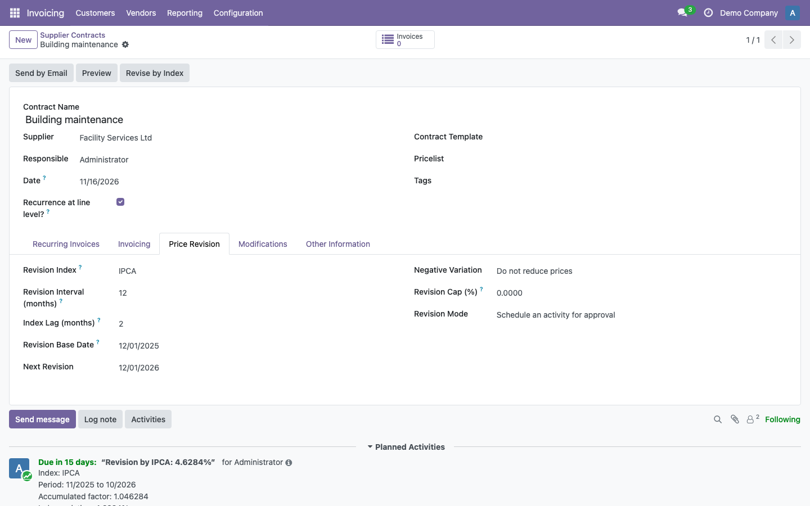

The rates of the index must be in *Monetary Index Update*: typed by hand
or fetched by a provider module (for Brazil, *monetary_index_update_bacen*
fetches IPCA, INPC, IGP-M and SELIC from the Banco Central do Brasil).

On the contract, open the **Price Revision** tab and set:

- **Revision Index**: the index used to revise the prices.
- **Revision Interval (months)**: months between two revisions, 12 by
  default. It is also the number of monthly rates accumulated.
- **Index Lag (months)**: months between the end of the accumulated period
  and the month of the revision. With 1, a revision in December uses the
  rates up to November; with 2, up to October. Consumer price indexes are
  usually published around the 10th of the following month, so a lag of 2
  lets the revision be prepared before its date.
- **Revision Base Date**: date of the current price (the contract start by
  default). The **Next Revision** is the base date plus the interval.
- **Negative Variation**: do not reduce prices (default) or apply the
  negative variation.
- **Revision Cap (%)**: maximum variation of one revision; zero means no cap.
- **Revision Mode**: schedule an activity for approval (default) or apply
  automatically.

