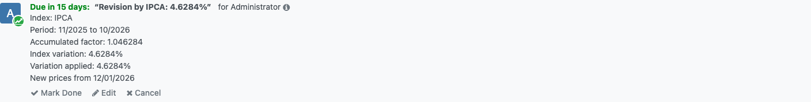
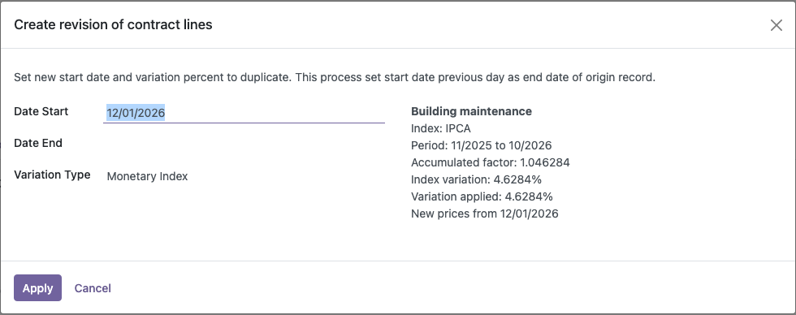
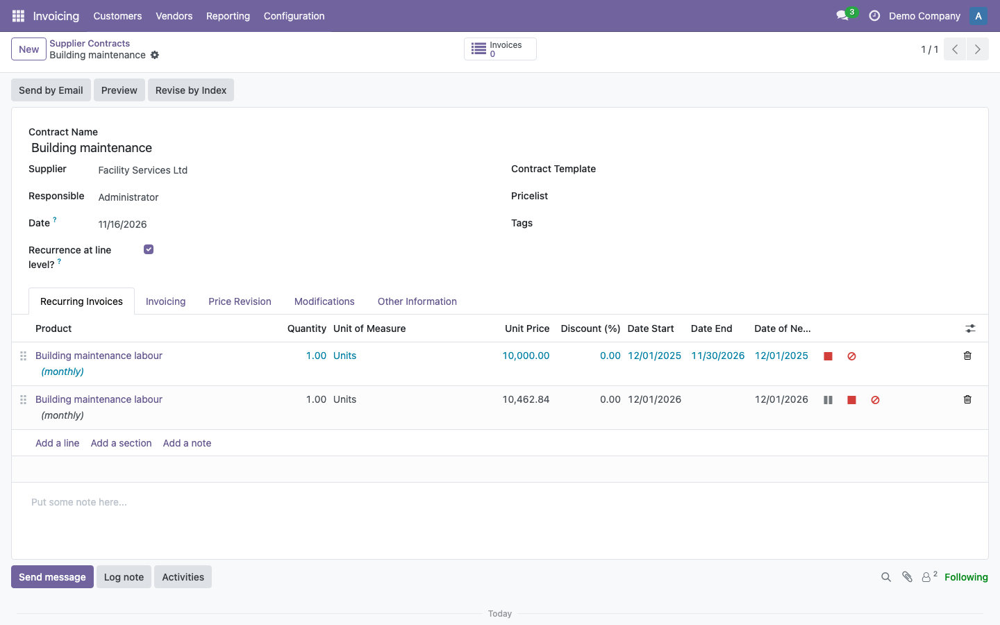

A daily scheduled action looks for contracts whose next revision is within
five days and whose index has every rate of the period published.

**Approval mode (default).** The action schedules one *Contract revision by
index* activity for the contract responsible (or, without a responsible, for
the user who created the contract), due on the revision date, with the
index, period, accumulated factor and percentage.

To approve, click **Revise by Index** on the contract. The wizard of
*Contract Price Revision* opens with the *Monetary Index* variation type and
a preview of each selected contract. Click **Apply**.

The current line ends on the day before the revision date and a new line
starts with the revised price. The new line keeps the index, the period,
the factor and the percentage applied; the calculation is also posted in
the contract chatter, the base date moves to the revision date and the
activity is marked as done.

**Automatic mode.** On the revision date the scheduled action applies the
revision without the wizard, with the same result.

The revision can also be run by hand at any time, for one contract with
**Revise by Index** or for several contracts with the action **Create
revision of contract lines** and the *Monetary Index* variation type.
