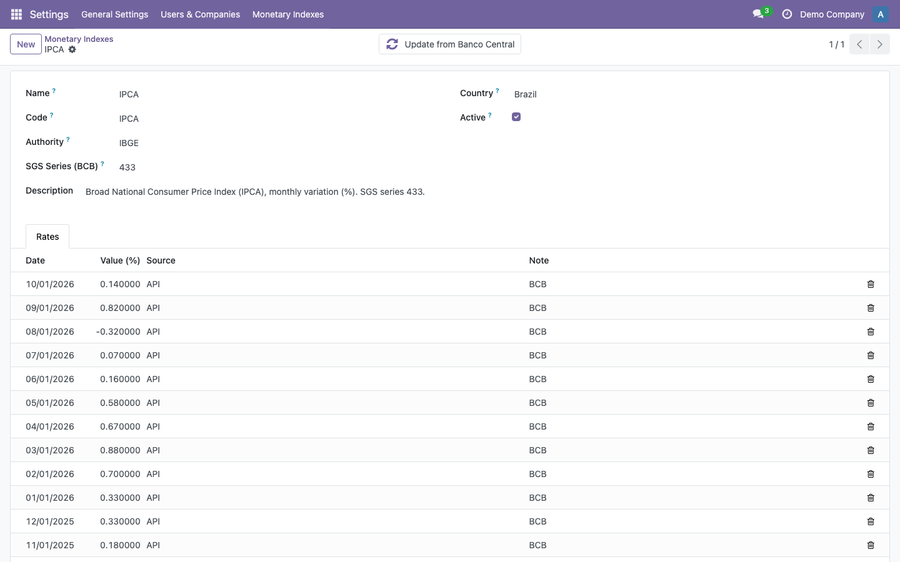
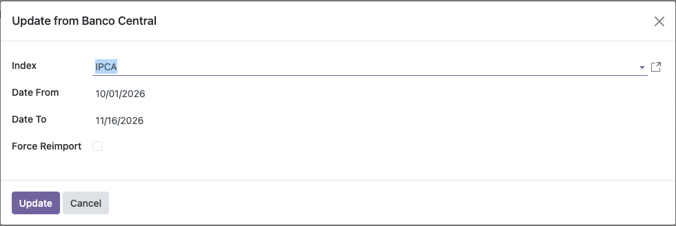

===============================================
Monetary Index Update - Banco Central do Brasil
===============================================

.. 
   !!!!!!!!!!!!!!!!!!!!!!!!!!!!!!!!!!!!!!!!!!!!!!!!!!!!
   !! This file is generated by oca-gen-addon-readme !!
   !! changes will be overwritten.                   !!
   !!!!!!!!!!!!!!!!!!!!!!!!!!!!!!!!!!!!!!!!!!!!!!!!!!!!
   !! source digest: sha256:77176a7f7de1a69f3b6a99555057999cb003281088118095cdac2d6ede6e85f4
   !!!!!!!!!!!!!!!!!!!!!!!!!!!!!!!!!!!!!!!!!!!!!!!!!!!!

.. |badge1| image:: https://img.shields.io/badge/maturity-Beta-yellow.png
    :target: https://odoo-community.org/page/development-status
    :alt: Beta
.. |badge2| image:: https://img.shields.io/badge/licence-LGPL--3-blue.png
    :target: http://www.gnu.org/licenses/lgpl-3.0-standalone.html
    :alt: License: LGPL-3
.. |badge3| image:: https://img.shields.io/badge/github-KMEE%2Fkmee--odoo--addons-lightgray.png?logo=github
    :target: https://github.com/KMEE/kmee-odoo-addons/tree/18.0/monetary_index_update_bacen
    :alt: KMEE/kmee-odoo-addons

|badge1| |badge2| |badge3|

This module fetches Brazilian monetary indexes from the Time Series
Management System (SGS) of the Banco Central do Brasil (BCB) into
*Monetary Index Update*.

It comes with SELIC (SGS series 4390), IPCA (433), INPC (188) and IGP-M
(189). Any other SGS series is fetched by setting its code on the index.

It replaces *monetary_index_update_selic*: in a database that has the
old module installed, updating *monetary_index_update* renames it and
keeps its records.

**Table of contents**

.. contents::
   :local:

Usage
=====

A daily scheduled action fetches again the last three months of every
index with an SGS series code (monthly series are published around the
10th of the following month and may be revised).

To load a period by hand, for example the history before using an index,
open the index and click **Update from Banco Central**.

|IPCA index with its SGS series and rates|

|Update from Banco Central wizard|

To add another index, create it in *Monetary Indexes* and fill in the
**SGS Series (BCB)** code.

Bug Tracker
===========

Bugs are tracked on `GitHub Issues <https://github.com/KMEE/kmee-odoo-addons/issues>`_.
In case of trouble, please check there if your issue has already been reported.
If you spotted it first, help us to smash it by providing a detailed and welcomed
`feedback <https://github.com/KMEE/kmee-odoo-addons/issues/new?body=module:%20monetary_index_update_bacen%0Aversion:%2018.0%0A%0A**Steps%20to%20reproduce**%0A-%20...%0A%0A**Current%20behavior**%0A%0A**Expected%20behavior**>`_.

Do not contact contributors directly about support or help with technical issues.

Credits
=======

Authors
-------

* KMEE

Contributors
------------

- `KMEE <https://www.kmee.com.br>`__:

  - Luis Felipe Mileo

Maintainers
-----------

This module is part of the `KMEE/kmee-odoo-addons <https://github.com/KMEE/kmee-odoo-addons/tree/18.0/monetary_index_update_bacen>`_ project on GitHub.

You are welcome to contribute.
