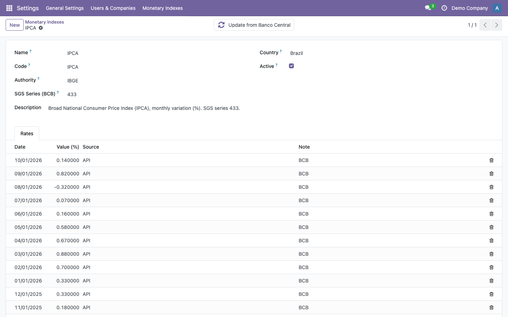
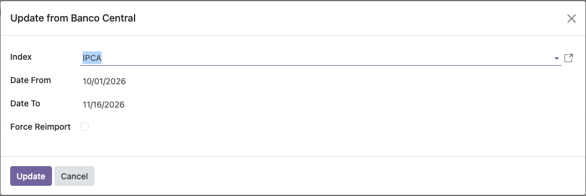

A daily scheduled action fetches again the last three months of every index
with an SGS series code (monthly series are published around the 10th of
the following month and may be revised).

To load a period by hand, for example the history before using an index,
open the index and click **Update from Banco Central**.

To add another index, create it in *Monetary Indexes* and fill in the
**SGS Series (BCB)** code.
